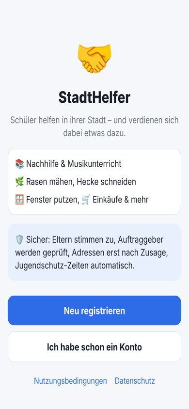
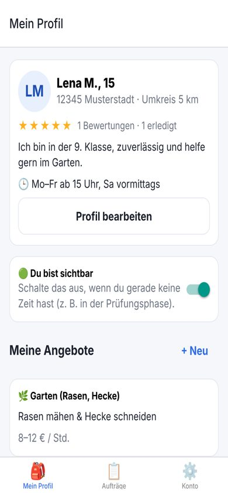
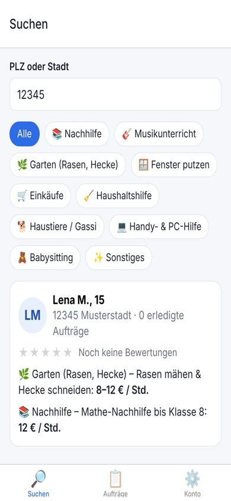
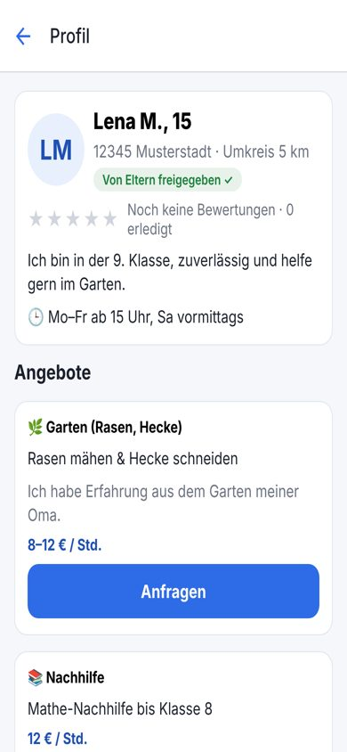
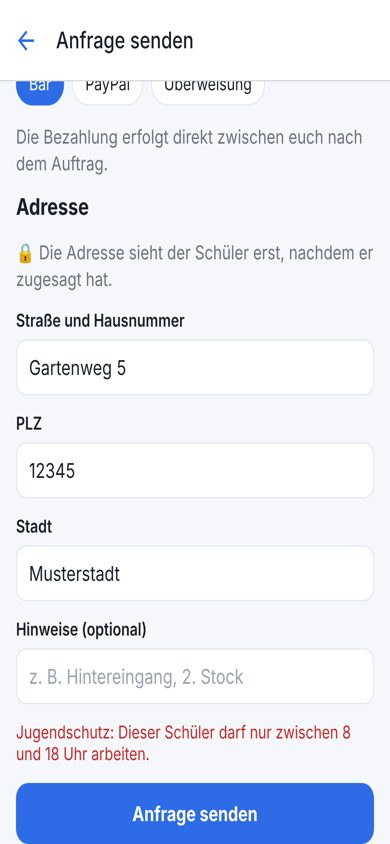
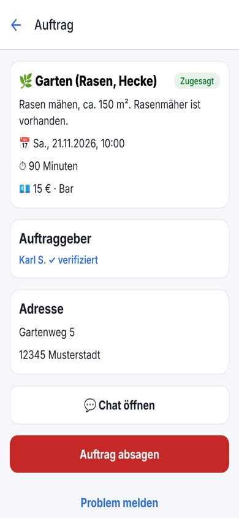
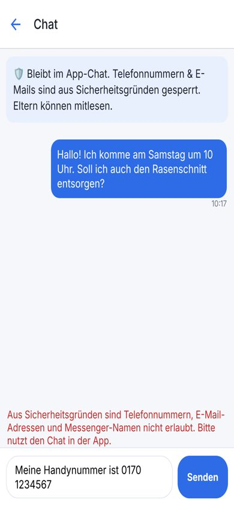
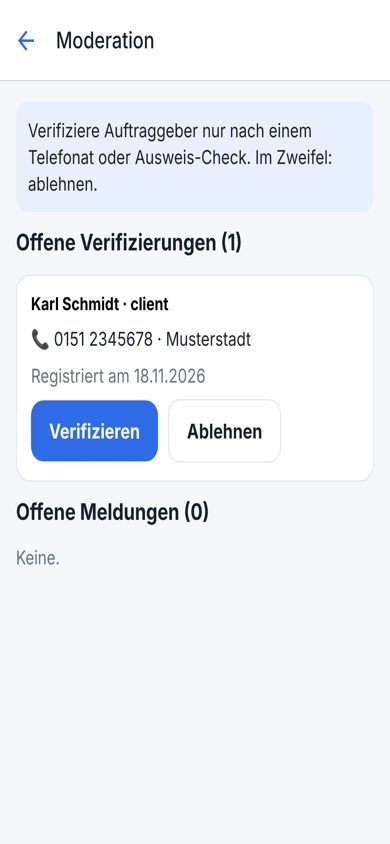

# StadtHelfer – Schüler helfen in ihrer Stadt

Eine App für iPhone und Android. Schülerinnen und Schüler ab 14 Jahren bieten darüber Hilfe an, zum Beispiel
Nachhilfe, Musikunterricht, Rasen mähen, Hecke schneiden, Fenster putzen oder Einkäufe. Privatpersonen
in der Stadt buchen sie.

> „StadtHelfer“ ist nur ein **Arbeitstitel**. Den Namen änderst du in `app.json` (`name`, `slug`, `scheme`,
> `bundleIdentifier`, `package`) und in den Texten unter `src/`. Prüfe vor der Veröffentlichung, ob es den Namen
> schon als Marke gibt.

| Start | Schüler-Profil | Suche | Öffentliches Profil | Jugendschutz |
|---|---|---|---|---|
|  |  |  |  |  |

| Auftrag | Chat-Schutz | Eltern | Moderation |
|---|---|---|---|
|  |  |  |  |

---

## Funktionen

**Drei Rollen:** Schüler/in, Auftraggeber/in und Elternteil. Dazu kommt ein Admin-Bereich für die Moderation.

| Bereich | Was die App macht |
|---|---|
| **Profil** | Voller Name, Geburtsdatum, PLZ und Stadt werden gespeichert. **Öffentlich sichtbar sind nur Vorname, der erste Buchstabe des Nachnamens und das Alter** („Lena M., 15“). Dazu kommen Beschreibung, Zeiten, Umkreis und Bewertungen. |
| **Angebote** | 10 Kategorien (Nachhilfe, Musik, Garten, Fenster, Einkäufe, Haushalt, Haustiere, Technik, Babysitting, Sonstiges), jeweils mit Preisspanne pro Stunde oder pro Auftrag. |
| **Suche** | Nach Kategorie und PLZ oder Stadt. Treffer in der gleichen PLZ stehen oben, danach wird nach Bewertung sortiert. |
| **Aufträge** | Anfrage → Zusage oder Ablehnung → Erledigt, jederzeit absagbar. Termin, Dauer, Preis und Bezahlart (bar, PayPal, Überweisung). |
| **Chat** | Pro Auftrag, in Echtzeit. |
| **Bewertungen** | Beide Seiten bewerten sich nach Abschluss mit 1–5 Sternen. |
| **Eltern** | Das Kind bekommt einen 8-stelligen Code. Ein Elternteil verknüpft sich damit, **stimmt zu oder widerruft**, sieht alle Aufträge und Chats und kann Aufträge absagen. |
| **Verifizierung** | Auftraggeber können erst Anfragen senden, wenn das Team sie verifiziert hat, zum Beispiel per Telefonat. |
| **Jugendschutz** | Unter 15 Jahren oder vollzeitschulpflichtig: nur 8–18 Uhr und höchstens 2 Stunden pro Tag. Mit 15–17 Jahren: 6–20 Uhr und höchstens 8 Stunden. Die App prüft das **automatisch**, auch die Summe aller Aufträge eines Tages. |
| **Adressschutz** | Die genaue Adresse sieht der Schüler erst, **nachdem er zugesagt hat**. |
| **Kontaktdaten-Filter** | Telefonnummern, E-Mail-Adressen und Messenger-Namen werden im Chat, im Profil und in Angeboten blockiert. |
| **Melden und Blockieren** | Jede Person und jeder Auftrag lässt sich melden. Blockierte Nutzer sehen sich gegenseitig nicht mehr. |
| **Moderation** | Admins verifizieren Auftraggeber, bearbeiten Meldungen und sperren Konten. |
| **Konto löschen** | Direkt in der App. Apple verlangt das. |

Wichtig: Alle Sicherheitsregeln prüft **die Datenbank selbst** (Row Level Security und Trigger). Sie gelten
also auch dann, wenn jemand die App umgeht.

## Technik

- **App:** [Expo](https://expo.dev) (React Native) mit TypeScript und Expo Router. Ein gemeinsamer Code für iOS, Android und Web.
- **Backend:** [Supabase](https://supabase.com) mit Postgres-Datenbank, Login und Echtzeit-Chat. Der kostenlose Tarif reicht für den Start.
- **Build und Upload in den App Store:** [EAS](https://expo.dev/eas). **Ein eigener Mac ist nicht nötig.**

```
src/app/              Bildschirme (jede Datei = eine Seite)
  (auth)/             Willkommen, Anmelden, Registrieren
  (tabs)/             Start (je nach Rolle), Aufträge, Konto
  student/[id]        Öffentliches Schüler-Profil
  request/[studentId] Anfrage-Formular
  job/[id]            Auftragsdetails, Zusage, Bewertung
  chat/[jobId]        Chat
  parent/…            Kind verknüpfen und freigeben
  admin, report, blocked, legal/…
src/components/       UI-Bausteine
src/lib/              Supabase-Client, Login, Regeln (Jugendschutz, Filter …)
supabase/migrations/  Datenbank-Schema mit allen Sicherheitsregeln
supabase/tests/       Automatische Tests der Sicherheitsregeln
```

---

## Schritt 1: Datenbank einrichten (Supabase, ca. 10 Minuten)

1. Konto auf [supabase.com](https://supabase.com) anlegen und **New project** wählen.
   Als Region **Frankfurt (eu-central-1)** nehmen, das ist wichtig für die DSGVO.
2. Links **SQL Editor** öffnen, den kompletten Inhalt von
   `supabase/migrations/20261118000000_init.sql` einfügen und **Run** klicken.
3. Unter **Authentication → Sign In / Providers → Email** die Option „Confirm email“ eingeschaltet lassen.
4. Unter **Project Settings → API** die **Project URL** und den **anon / publishable key** kopieren.
5. Im Projektordner:
   ```bash
   cp .env.example .env
   # .env öffnen und die beiden Werte eintragen
   ```
   Den `service_role`- bzw. Secret-Key **niemals** in die App eintragen.

### Admin-Konto festlegen
Registriere dich zuerst normal in der App. Dann im Supabase SQL Editor ausführen:
```sql
update profiles set is_admin = true
where id = (select id from auth.users where email = 'deine@email.de');
```
Danach findest du in der App unter **Konto** den Punkt **🛠 Moderation**.

## Schritt 2: App auf dem eigenen Handy testen

```bash
npm install
npx expo start
```
Installiere auf dem iPhone die App **Expo Go** aus dem App Store und scanne den QR-Code aus dem Terminal.
Die App öffnet sich sofort, ganz ohne App Store. Mit `npx expo start --web` läuft sie auch im Browser.

## Schritt 3: In den App Store bringen

**Voraussetzungen**
- **Apple Developer Program**, 99 € pro Jahr: [developer.apple.com/programs](https://developer.apple.com/programs/).
  Willst du als Firma statt als Privatperson veröffentlichen, brauchst du eine D-U-N-S-Nummer (kostenlos, dauert ein paar Tage).
- Ein kostenloses Konto auf [expo.dev](https://expo.dev).

**Ablauf**
```bash
npx eas-cli@latest login
npx eas-cli@latest init                      # verknüpft das Projekt mit expo.dev

# Supabase-Zugangsdaten für die Builds hinterlegen
npx eas-cli@latest env:create --name EXPO_PUBLIC_SUPABASE_URL --value https://….supabase.co --environment production --visibility plaintext
npx eas-cli@latest env:create --name EXPO_PUBLIC_SUPABASE_ANON_KEY --value … --environment production --visibility plaintext

npx eas-cli@latest build --platform ios --profile production   # baut die App in der Cloud (~15–20 Min.)
npx eas-cli@latest submit --platform ios                        # lädt sie zu App Store Connect hoch
```
EAS fragt beim ersten Build nach deinem Apple-Login und erstellt Zertifikate und Profile automatisch.
Danach geht es in [App Store Connect](https://appstoreconnect.apple.com) weiter:
1. Die App erscheint zuerst in **TestFlight**. Damit kannst du sie mit Freunden testen.
2. Fülle unter **App Store** die Beschreibung, die Screenshots und die Pflichtangaben aus (Checkliste unten).
3. Klicke auf **Zur Prüfung einreichen**. Die Prüfung dauert meistens 1–3 Tage.

**Android / Google Play** (einmalig 25 $): `npx eas-cli@latest build --platform android` und danach `submit`.

### Checkliste für die Apple-Prüfung
- [ ] **Bundle ID** in `app.json` anpassen (z. B. `de.deinname.stadthelfer`), sie muss weltweit eindeutig sein.
- [ ] **App-Icon** (1024×1024) in `assets/icon.png` ersetzen.
- [ ] **Datenschutzerklärung als Webseite** (Apple verlangt eine URL) und eine **Support-URL**.
- [ ] **Test-Zugänge für Apple** im Feld „App Review Information“ angeben: einen verifizierten Auftraggeber und
      einen freigegebenen Schüler, damit die Prüfer alles ausprobieren können.
- [ ] **App Privacy** („Datenschutz-Etiketten“): Name, E-Mail, Telefonnummer, Geburtsdatum, grober Standort (PLZ),
      Nachrichten. Alles „mit Nutzer verknüpft“, „kein Tracking“.
- [ ] **Altersfreigabe**: Im Fragebogen „User-Generated Content“ angeben. Die Schutzfunktionen, die Apple dafür
      verlangt (Melden, Blockieren, Filter, Moderation), sind schon eingebaut.
- [ ] **Screenshots** für das 6,9"-iPhone, zum Beispiel aus dem iOS-Simulator oder vom Handy.

## Vor dem Start: Rechtliches (bitte nicht überspringen)
Die App richtet sich an Minderjährige. Lass deshalb vorher **anwaltlich prüfen**:
- **Nutzungsbedingungen und Datenschutzerklärung.** In der App sind Entwürfe enthalten
  (`src/app/legal/`), Platzhalter stehen in `[eckigen Klammern]`.
- Ein **Impressum** ist Pflicht (§ 5 DDG).
- **Auftragsverarbeitungsvertrag** mit Supabase (DPA im Supabase-Dashboard).
- Die **Jugendarbeitsschutz-Regeln** in der App sind bewusst streng, ersetzen aber keine Rechtsberatung.
- Wer Gebühren oder Provisionen nimmt, braucht in der Regel ein **Gewerbe**.

## Tests

```bash
npm run typecheck   # TypeScript-Prüfung
npm test            # Logik-Tests (Jugendschutz, Kontaktdaten-Filter, Zeitzonen)
npm run test:db     # Sicherheitsregeln der Datenbank (braucht ein lokal installiertes PostgreSQL)
```
`test:db` startet eine temporäre Datenbank und prüft über 50 Fälle. Beispiele: Wer sieht welche Daten?
Wann ist die Adresse sichtbar? Greifen die Jugendschutz-Zeiten? Funktionieren Blockieren und Konto löschen?

## Mögliche nächste Schritte
- Push-Benachrichtigungen bei neuen Anfragen und Nachrichten (`expo-notifications`)
- Echte Umkreissuche über Geodaten (PostGIS) statt PLZ-Region
- Automatische Ausweis-Prüfung für Auftraggeber
- Profilbilder. Sie sind aus Sicherheitsgründen bewusst noch nicht eingebaut. Wenn ihr sie wollt, dann nur mit Moderation.
- Bezahlung in der App (z. B. Stripe Connect). Das ist rechtlich und technisch deutlich aufwendiger.
