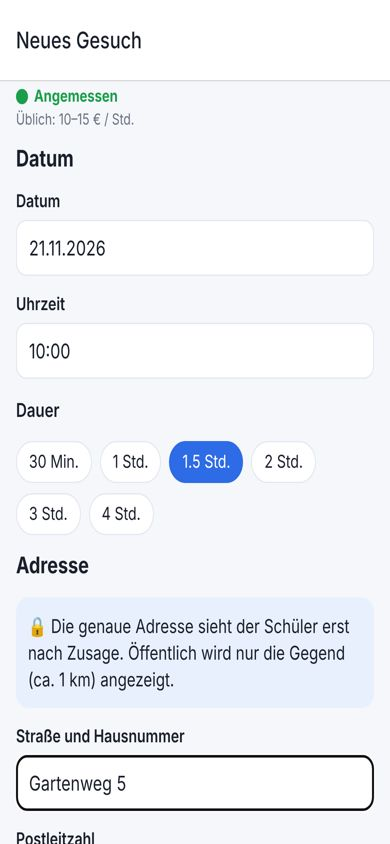
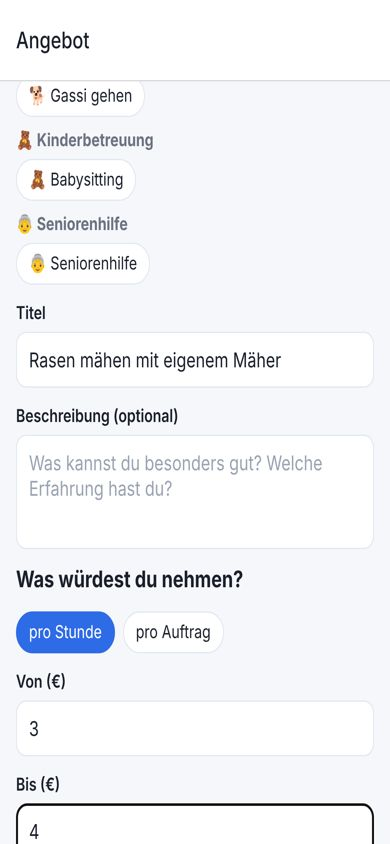
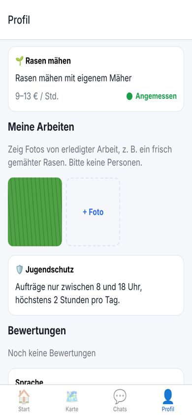
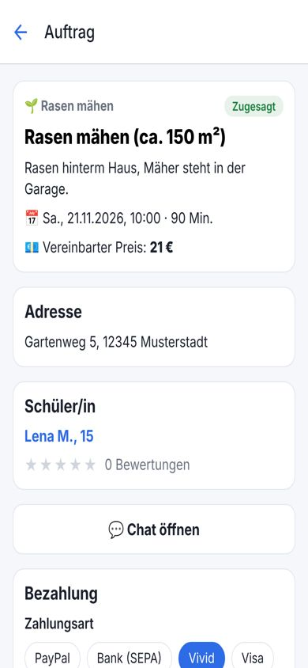
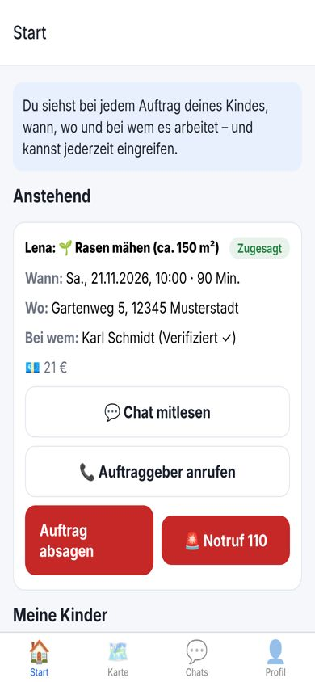
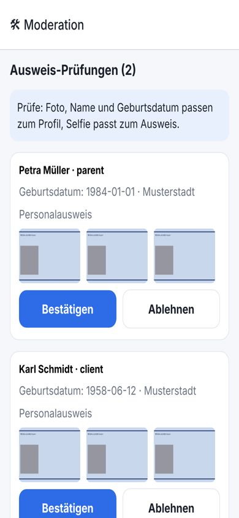
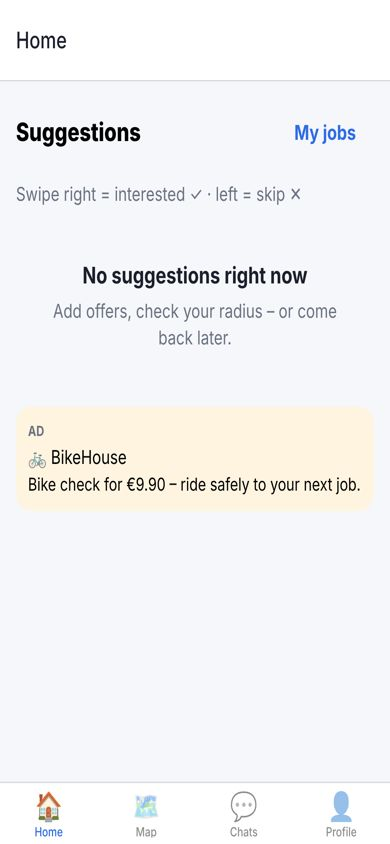

# StadtHelfer – Schüler helfen in ihrer Stadt

Eine iPhone-App, über die Schülerinnen und Schüler ab 14 Jahren Privatleuten in ihrer Stadt helfen und
sich so Geld dazuverdienen: Gartenarbeit, Fensterputzen, Unterricht (Tanzen, Yoga, Sport, Instrumente,
Nachhilfe), Einkäufe, Gassi gehen, Kinderbetreuung und Seniorenhilfe.

> „StadtHelfer“ ist ein **Arbeitstitel**. Der Name wird in `app.json` (`name`, `slug`, `scheme`,
> `bundleIdentifier`) und in `src/lib/strings.ts` geändert.

| Start | Wischen | Gesuch | Preis-Ampel | Arbeitsfotos |
|---|---|---|---|---|
|  |  |  |  |  |

| Bezahlen | Eltern: wo/wann/wer | Chat-Schutz | Ausweis-Prüfung | Englisch |
|---|---|---|---|---|
|  |  |  |  |  |

---

## So funktioniert die App

1. **Konto erstellen**, dann im Profil angeben, ob man **Hilfe anbietet** (Schüler), **Hilfe sucht**
   (Auftraggeber) oder **Elternteil** ist.
2. **Schüler** legen Angebote an: was sie machen und welche Preisspanne sie verlangen.
   **Auftraggeber** erstellen Gesuche: was zu tun ist, wann, wo, Fotos und welche Preisspanne sie zahlen würden.
3. Auf der Startseite gibt es **Vorschläge zum Wischen**. Schüler sehen passende Gesuche in ihrem Umkreis,
   Auftraggeber passende Schüler zu ihren Gesuchen. Nach rechts wischen heißt Interesse (Bewerbung bzw.
   Anfrage), nach links heißt weiter.
4. Die jeweils andere Seite sagt zu. Danach sieht der Schüler die genaue Adresse, und man spricht sich
   **im Chat** ab.
5. Der Auftraggeber **bezahlt in der App** mit PayPal, Bank, Vivid oder Visa. Das Geld wird verwahrt.
6. Wenn **beide auf „Fertig“ tippen**, wird das Geld ausgezahlt und der **Chat gelöscht**. Danach
   **bewerten** sich beide gegenseitig mit Sternen und einem kurzen Text.

### Vier Reiter (wie bei Instagram)
| 🏠 Start | 🗺️ Karte | 💬 Chats | 👤 Profil |
|---|---|---|---|
| Vorschläge zum Wischen, Meine Aufträge / Gesuche | Gesuche im Umkreis, Umkreis wählen (1–50 km). Eltern sehen, wo ihr Kind arbeitet | Alle laufenden Chats | Profil, Angebote, Arbeitsfotos, Bewertungen, Standort & Umkreis, Favoriten, Sprache, Einstellungen |

### Alle Funktionen
| Bereich | Umsetzung |
|---|---|
| **Profil** | Öffentlich sind nur Vorname, der erste Buchstabe des Nachnamens und das Alter („Lena M., 15“). Der volle Name und der Wohnort bleiben privat. |
| **Leistungen** | Garten (Rasen mähen, Unkraut zupfen, Hecke schneiden), Reinigung (Fenster putzen), Unterricht (Nachhilfe, Tanzen, Yoga, Sport, Instrument), Einkäufe, Gassi gehen, Kinderbetreuung (Babysitting, Tagesmutter *ab 18*), Seniorenhilfe |
| **Preisspanne + Ampel** | Schüler geben an, was sie nehmen würden, Auftraggeber, was sie zahlen würden. 🟢 angemessen, 🟡 leicht daneben, 🔴 deutlich zu wenig oder zu viel. Die Richtwerte stehen in `src/lib/rules.ts` (`REFERENCE_PRICE`). |
| **Umkreis & Karte** | Den eigenen Standort festlegen (GPS, Adresse oder Tippen auf die Karte), den Umkreis wählen und die Gesuche auf der Karte sehen. Die Karte ist Apple Maps und kostenlos. |
| **Vorschläge + Wischen** | Die Datenbank berechnet die Vorschläge nach Leistung, Umkreis und Jugendschutz-Zeiten. Favoriten erscheinen zuerst. |
| **Fotos** | Bis zu 5 Fotos pro Gesuch („das ist zu tun“) und bis zu 12 Arbeitsfotos im Schüler-Profil („das habe ich gemacht“). |
| **Favoriten** | ♡ auf Profilen und Vorschlagskarten. |
| **Chat** | Pro Auftrag, in Echtzeit. Telefonnummern, E-Mails und Messenger-Namen werden blockiert. |
| **Bewertungen** | 1–5 Sterne und ein kurzer Text, gegenseitig nach Abschluss. |
| **Eltern** | Freigabe per Code. Eltern sehen bei jedem Auftrag **wann, wo und bei wem** (voller Name und Telefon des verifizierten Auftraggebers) und können **mitlesen, absagen, anrufen oder den Notruf 110 wählen**. |
| **Ausweis-Prüfung** | Auftraggeber, Eltern und Schüler ab 16 laden Vorderseite, Rückseite und ein Selfie hoch. Das Moderationsteam prüft, danach werden die Bilder gelöscht. Unter 16 genügt ein verifizierter Elternteil, weil es den Personalausweis erst ab 16 gibt. |
| **Jugendschutz** | Unter 15 oder vollzeitschulpflichtig: nur 8–18 Uhr, höchstens 2 Std. pro Tag. 15–17 Jahre: 6–20 Uhr, höchstens 8 Std. Das wird automatisch geprüft. |
| **Melden & Blockieren** | Melden mit Grund und Beschreibung. **Nach 3 Meldungen von verschiedenen Personen wird das Konto automatisch gesperrt.** Das Moderationsteam sieht den Chat und kann sperren oder entsperren. |
| **Chat löschen** | Wenn beide „Fertig“ bestätigen, verschwindet der Chat sofort. Endgültig gelöscht wird er nach 7 Tagen (Begründung unten). |
| **Sprachen** | Deutsch und Englisch, wählbar im Profil oder auf der Startseite. Alle Texte stehen in `src/lib/strings.ts`. |
| **Werbung** | Platzhalter-Anzeigen (frei erfunden), als „Anzeige“ gekennzeichnet, im Wisch-Stapel und in Listen. |
| **Nutzungsbedingungen** | Müssen bei der Registrierung akzeptiert werden. Entwürfe auf Deutsch und Englisch liegen in `src/app/legal/`. |
| **Konto löschen** | Direkt in der App. Apple verlangt das. |

Alle Sicherheitsregeln prüft **die Datenbank selbst** (Row Level Security und Trigger). Sie gelten
also auch dann, wenn jemand die App umgeht.

### Was (noch) nicht echt ist – und warum
| Punkt | Stand | Was für den Start fehlt |
|---|---|---|
| **Bezahlung** | Läuft im **Testmodus**: Es wird kein echtes Geld bewegt, aber der gesamte Ablauf (zahlen → verwahren → auszahlen bzw. erstatten) ist fertig. | Ein Zahlungsdienstleister wie **Stripe Connect** oder **PayPal Commerce Platform** (unterstützt Karten wie Visa/Vivid, SEPA und PayPal). Wer Geld für andere verwahrt, braucht so einen lizenzierten Anbieter. Ihr braucht dafür ein Gewerbe. Für Auszahlungen an Minderjährige läuft das Auszahlungskonto meist über die Eltern. |
| **Ausweis-Prüfung** | Upload und **manuelle Prüfung** durch euch im Moderationsbereich. | Automatische Prüfung mit einem Anbieter wie IDnow, Veriff oder Persona (ca. 1–3 € pro Prüfung). Der Upload-Bildschirm ist dafür vorbereitet. |
| **Werbung** | Erfundene Platzhalter. | Ein Werbenetzwerk mit **nicht personalisierter** Werbung. Personalisierte Werbung an Minderjährige ist in der EU verboten (DSA Art. 28). |
| **Push-Benachrichtigungen** | Noch nicht eingebaut. Neues erscheint beim Öffnen der App. | `expo-notifications` und eine Supabase-Funktion, die z. B. die Eltern bei jeder Zusage benachrichtigt. |
| **Chat löschen** | Für die Nutzer sofort weg, endgültig gelöscht nach **7 Tagen**. | Die 7 Tage sind bewusst gewählt: Meldet jemand nach dem Auftrag ein Problem, kann das Moderationsteam den Chat noch prüfen. Den Zeitraum ändert ihr in `purge_finished_chats()`. Dafür muss in Supabase die Erweiterung **pg_cron** aktiv sein. |
| **Tagesmutter** | Nur ab 18 wählbar. | Tagespflege braucht eine Pflegeerlaubnis vom Jugendamt (§ 43 SGB VIII). Das prüft die App nicht. |

## Technik
- **App:** [Expo](https://expo.dev) SDK 58 (React Native) mit TypeScript und Expo Router. Ziel ist das iPhone, im Browser läuft die App nur zum Testen.
- **Backend:** [Supabase](https://supabase.com) mit Postgres, Login, Speicher für Fotos und Echtzeit-Chat. Der kostenlose Tarif reicht für den Start.
- **Build und Upload in den App Store:** [EAS](https://expo.dev/eas). Ein eigener Mac ist nicht nötig.

```
src/app/(tabs)/        Start · Karte · Chats · Profil
src/app/post/          Gesuch erstellen / ansehen
src/app/job/[id]       Auftrag: Zusage, Bezahlung, Fertig, Bewertung
src/app/chat/[jobId]   Chat
src/app/student/[id]   Öffentliches Schüler-Profil (Arbeitsfotos, Favorit, anfragen)
src/app/verify         Ausweis-Prüfung
src/app/location       Standort & Umkreis
src/app/parent/…       Kind verknüpfen, freigeben, begleiten
src/app/admin          Moderation (Ausweise, Meldungen, Sperren)
src/components/        SwipeDeck, AppMap, PriceLight, AdBanner, PhotoGrid …
src/lib/strings.ts     Alle Texte (Deutsch + Englisch)
src/lib/rules.ts       Leistungen, Richtpreise, Jugendschutz, Filter
supabase/migrations/   Datenbank inkl. aller Sicherheitsregeln
supabase/tests/        Automatische Tests der Sicherheitsregeln
```

---

## Schritt 1: Datenbank einrichten (Supabase, ca. 10 Minuten)
1. Konto auf [supabase.com](https://supabase.com) anlegen und **New project** wählen. Als Region **Frankfurt** nehmen.
2. Unter **Database → Extensions** die Erweiterung **pg_cron** einschalten. Sie löscht abgeschlossene Chats automatisch.
3. Im **SQL Editor** den kompletten Inhalt von `supabase/migrations/20261118000000_init.sql` einfügen und **Run** klicken.
   Dabei werden auch die privaten Foto-Speicher `photos` und `id-documents` angelegt.
   *Falls ihr die erste Version schon eingespielt habt:* Unter Project Settings das Projekt zurücksetzen
   oder ein neues anlegen.
4. Unter **Project Settings → API** die URL und den **anon / publishable key** kopieren und eintragen:
   ```bash
   cp .env.example .env    # Werte eintragen. Den service_role-Key NIEMALS eintragen!
   ```
5. **Admin werden:** Registriere dich in der App und führe dann im SQL Editor aus:
   ```sql
   update profiles set is_admin = true, verification_status = 'verified'
   where id = (select id from auth.users where email = 'deine@email.de');
   ```
   Danach findest du unter **Profil → 🛠 Moderation** die Ausweis-Prüfungen, Meldungen und Sperren.

## Schritt 2: Auf dem eigenen iPhone testen
```bash
npm install
npx expo start
```
Installiere auf dem iPhone die App **Expo Go** und scanne den QR-Code. Karte, Kamera, Fotos und Standort
funktionieren in Expo Go.

## Schritt 3: In den App Store
- **Apple Developer Program:** 99 € pro Jahr. Der Kontoinhaber muss **volljährig** sein. Bei Minderjährigen schließt ein Elternteil die Mitgliedschaft ab.
- Ein kostenloses Konto auf [expo.dev](https://expo.dev).

```bash
npx eas-cli@latest login
npx eas-cli@latest init
npx eas-cli@latest env:create --name EXPO_PUBLIC_SUPABASE_URL --value https://….supabase.co --environment production --visibility plaintext
npx eas-cli@latest env:create --name EXPO_PUBLIC_SUPABASE_ANON_KEY --value … --environment production --visibility plaintext
npx eas-cli@latest build --platform ios --profile production
npx eas-cli@latest submit --platform ios
```
Danach in [App Store Connect](https://appstoreconnect.apple.com) erst mit **TestFlight** testen, dann die
Beschreibung, Screenshots und Pflichtangaben ausfüllen und **zur Prüfung einreichen**.

### Checkliste für die Apple-Prüfung
- [ ] **Bundle ID** in `app.json` anpassen (z. B. `de.deinname.stadthelfer`) und **App-Icon** (`assets/icon.png`, 1024×1024) ersetzen.
- [ ] **Datenschutzerklärung und Support-Seite als Webseiten**. Apple verlangt URLs.
- [ ] **Test-Zugänge für die Apple-Prüfer:** einen verifizierten Auftraggeber und einen freigegebenen Schüler mit Standort.
- [ ] **App Privacy:** Name, E-Mail, Telefon, Geburtsdatum, genauer Standort, Fotos, Nachrichten, Zahlungsinfos. Alles „mit Nutzer verknüpft“, kein Tracking.
- [ ] **Altersfreigabe:** „User-Generated Content“ angeben. Melden, Blockieren, Filter und Moderation sind vorhanden.
- [ ] Beim echten Bezahlen: Für Dienstleistungen in der realen Welt gilt nicht der Apple-In-App-Kauf (Richtlinie 3.1.3(e)). Stripe/PayPal sind hier erlaubt.

## Vor dem Start: Rechtliches
Weil die App sich an Minderjährige richtet, sollten diese Punkte **anwaltlich geprüft** werden:
- Nutzungsbedingungen und Datenschutzerklärung (Entwürfe liegen in der App), dazu ein **Impressum**.
- **Speicherung von Ausweiskopien:** nur mit Einwilligung, als Kopie erkennbar, Schwärzen erlauben, nach der Prüfung löschen (§ 20 PAuswG). Die App löscht die Bilder bereits nach der Prüfung.
- **Zahlungsabwicklung** nur über einen lizenzierten Anbieter. Ihr braucht dafür ein **Gewerbe**.
- **Auftragsverarbeitungsverträge** mit Supabase und dem Zahlungsanbieter.
- Die **Jugendarbeitsschutz-Regeln** in der App sind bewusst streng, ersetzen aber keine Rechtsberatung.

## Tests
```bash
npm run typecheck   # TypeScript
npx expo lint       # Codequalität
npm test            # Logik: Jugendschutz, Preis-Ampel, Kontaktdaten-Filter, Zeitzonen, Entfernungen
npm run test:db     # 69 Prüfungen der Datenbank-Sicherheitsregeln (braucht lokales PostgreSQL)
```
